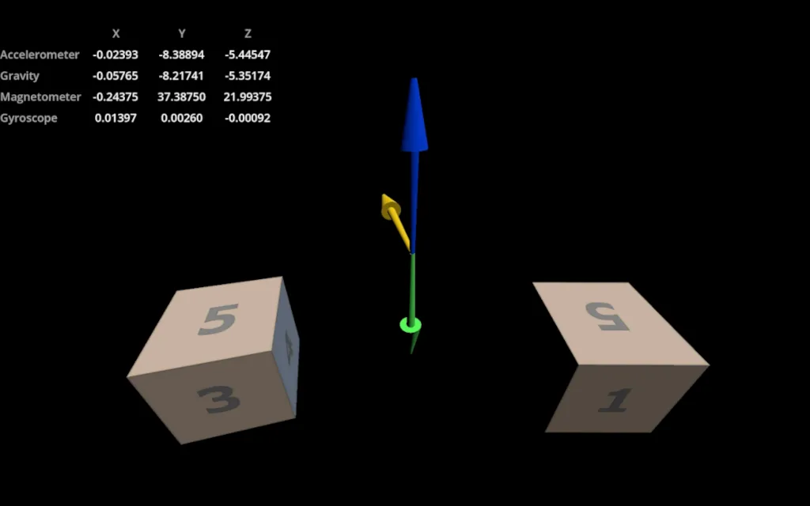
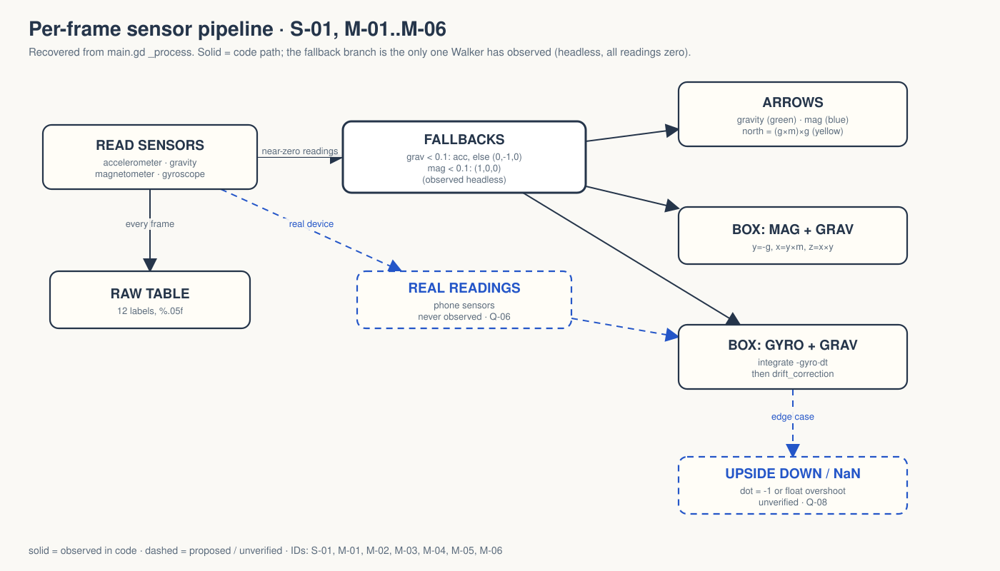

# walker-mobile-sensors — Game Design Document (recovered)

| | |
|---|---|
| Version | 0.1.0-recovered |
| Date | 2026-09-27 |
| Author | Zelda (agent, `/gdd reverse --path godot silent`), for Nik Bear Brown |
| Mode | recovered, silent |
| Gate | gate — unsigned at time of writing (vision ○ · systems ○ · world ○ · scope ○) |
| Revision | 1 |
| Source | Godot demo `mobile/sensors`, upstream commit `a3b5c113112f77291d5f3d1360f33a882fdc52f7`, local copy in `godot/` |
| Kind | **Sensor-visualization tech demo. Not a game.** |

Provenance tags: `[OBSERVED path:line]` the code does this (paths relative to `godot/`) · `[INFERRED]` implied, evidence stated · `[MISSING]` the code cannot tell you this. Numbers in code are observed values, not approved design. This document describes what exists; it approves nothing.

*`[OBSERVED godot/README.md:14]` screenshot shipped with the upstream Godot demo. Not a Walker capture; Walker ran headless, where every sensor reads zero (`../fallback-20260926.log`).*

## 1. Vision summary

**What it is.** One 3D scene with a table of raw accelerometer, gravity, magnetometer and gyroscope readings (X/Y/Z, five decimals), three arrows (gravity, magnetometer, computed north) and two textured boxes that show two ways to orient an object to the device: magnetometer + gravity, and gyroscope integration with gravity drift correction `[OBSERVED main.gd:98-158; main.tscn:44-240]`.

**Stated purpose.** "A demo showing the use of various sensors: an accelerometer, a gyroscope, and a magnetometer. These sensors are typically found on mobile devices, so don't expect this to work on a desktop." `[OBSERVED project.godot:14-15]` The script comments frame it as teaching: "helper functions that show how you can use the raw sensor data to determine the orientation of your phone" and "none of this logic filters data ... I wanted to keep this straight forward" `[OBSERVED main.gd:3-10]`.

**Why it is in Walker.** `[MISSING]` Not stated. `[INFERRED]` from the Walker README: one of a series of adapted Godot demos, verified headlessly and slated for two narrated films.

**User.** `[INFERRED]` a developer learning to turn raw phone sensors into an orientation.

**Player fantasy, PX goals, win condition.** None. **Ghost Center**, expected.

**Biggest unresolved question.** On desktop, every visual here is driven by placeholder fallback vectors, not by sensors. How will anyone see real behavior, and on what device? (Q-06)

## 2. Design pillars

None declared `[MISSING]`. Implicit priorities `[INFERRED]`:

| ID | Implicit priority | Evidence |
|---|---|---|
| IP-01 | Show raw data before derived data | the readings table is updated first each frame `[main.gd:105-122]` |
| IP-02 | Compare two orientation methods side by side | two boxes, two methods `[main.gd:149-158]` |
| IP-03 | Clarity over accuracy | "none of this logic filters data" `[main.gd:5-6]` |
| IP-04 | Degrade, never crash, when sensors are missing | fallbacks: gravity from accelerometer, else (0, −1, 0); magnetometer (1, 0, 0) `[main.gd:124-135]` |

## 3. Core loop

**Micro (per frame).** Read four sensors → print raw values → substitute fallbacks where readings are near zero → orient three arrows → orient two boxes `[OBSERVED main.gd:98-158]`.
**Meso.** Tilt, turn and shake the device; watch arrows and boxes respond, and compare the two boxes `[INFERRED from main.gd:149-156 comments]`.
**Macro.** None.

**Loop honesty test.** An instrument panel. No stakes. Judge it as a teaching demo.

## 4. Player Experience Goals

`[MISSING]` None written. Candidates `[INFERRED]`, not approved:

| ID | The user should… | when… | Evidence | Tested by |
|---|---|---|---|---|
| PX-01? | see the gravity arrow stay pointing down as the phone tilts | on a phone | main.gd:137-138 | none; no device `[MISSING]` |
| PX-02? | see the north arrow stay horizontal and point north | on a phone with a magnetometer | main.gd:145-147 | none |
| PX-03? | see why gyro + drift correction beats mag + gravity | moving the phone near a magnet | main.gd:149-158 | none |

## 5. Mechanics

### M-01 Raw readout `[OBSERVED main.gd:100-122; main.tscn:60-179]`
`Input.get_accelerometer()`, `get_gravity()`, `get_magnetometer()`, `get_gyroscope()`; each component printed with `"%.05f"` into twelve unique-named labels (`%AccX` … `%GyroZ`).

### M-02 Missing-sensor fallbacks `[OBSERVED main.gd:124-135]`
If |gravity| < 0.1: use the accelerometer if |acc| ≥ 0.1, else (0, −1, 0). If |mag| < 0.1: use (1, 0, 0). These are placeholders, not measured north or gravity `[OBSERVED ../FRICTIONAL.md]`. On the headless run all four sensors read (0, 0, 0), so both fallbacks were active `[OBSERVED ../fallback-20260926.log]`.

### M-03 Arrows `[OBSERVED main.gd:14-31, :137-147]`
`get_basis_for_arrow(v)`: y = v normalized; x, z by cross products with a helper axis (switches from X to Y when nearly parallel, |dot| > 0.9). Applied to the gravity vector ("AccelerometerArrow", which shows *gravity*, not raw acceleration `[main.gd:137-138]`), the magnetometer vector, and computed north. Colors: green, blue, yellow `[main.tscn materials 3, 5, 6]`.

### M-04 North `[OBSERVED main.gd:35-45]`
east = gravity × magnetometer; north = east × gravity; both normalized. The comment is unsure whether the first cross product gives east or west ("east (or is it west)") `[OBSERVED :39]`.

### M-05 Mag + gravity box `[OBSERVED main.gd:49-64, :152-153]`
y = −gravity, x = y × mag, z = x × y, then orthonormalized.

### M-06 Gyro + gravity box `[OBSERVED main.gd:70-95, :156-158]`
Rotate the current basis by −gyro × delta about its own x, y, z axes; orthonormalize; then rotate so basis.y aligns with −gravity (`drift_correction`, applied only when dot < 1.0). Edge `[INFERRED, unverified]`: if the box is exactly upside down (dot = −1) the correction axis is a zero vector, and a dot slightly outside [−1, 1] from float error would give `acos` = NaN.

## 6. Systems

### S-01 Per-frame pipeline `[OBSERVED main.gd:98-158]`
Stateless except the GyroAndGrav basis, which integrates over time `[main.gd:157-158]`. No filtering, no calibration, no persistence.

## 7. Progression
None `[OBSERVED]`.

## 8. World
Camera at z ≈ 12 facing three arrows at the origin and two 4 m boxes at x = ±7 textured with `cube_6.png`, a 3×2 atlas of numbered faces 1-6 so each side is identifiable `[OBSERVED main.tscn:4, :182-240; cube_6.png viewed]`. Ambient light plus one directional light. No world rules.

## 9. Narrative
None. Nothing invented.

## 10. Characters
None.

## 11. Features and priority

Priority `[MISSING]`. Levels: L1 loads · L2 exercised by an automated test · L3 rendered capture reviewed · L4 physical device + human review.

| ID | Feature | Code | Level |
|---|---|---|---|
| F-01 | Raw readout (M-01) | main.gd:100-122 | L2 (12 labels match zero readings) |
| F-02 | Missing-sensor fallbacks (M-02) | main.gd:124-135 | L2 (bases finite, determinant 1) |
| F-03 | Arrows (M-03) | main.gd:137-147 | L2 for fallback only |
| F-04 | North (M-04) | main.gd:35-45 | L2 for fallback only |
| F-05 | Mag + gravity box (M-05) | main.gd:152-153 | L2 for fallback only |
| F-06 | Gyro + gravity box (M-06) | main.gd:156-158 | L2 for fallback only |

Every L2 here tests *missing-sensor startup behavior*, not accuracy, orientation under movement, magnetic interference, gyro drift or device support `[OBSERVED ../FRICTIONAL.md]`. CORE % cannot be computed `[MISSING]`.

## 12. Out of scope (observed absences)
Filtering (explicitly omitted, main.gd:5-6); calibration; screen-orientation handling; any UI to switch methods. Whether intentional beyond the filtering comment: `[MISSING]`.

## 13. Technical
Godot 4.7.2, features "4.7", Compatibility renderer (desktop and mobile), ETC2/ASTC import, 3D MSAA 2× `[OBSERVED project.godot:13-34]`. The upstream README says "Renderer: Mobile" but project settings select Compatibility; no renderer change was made `[OBSERVED README.md:8; ../FRICTIONAL.md]`. Main scene `main.tscn` (root `Node` "Main" + `main.gd`). No `[input]` actions, no signals, no exported vars. Walker harness `test_fallback.gd` reads the actual headless sensor values and injects nothing `[OBSERVED test_fallback.gd:14-20]`.

## 14. Risks

| ID | Risk | Evidence | Severity |
|---|---|---|---|
| R-01 | Desktop zero readings or fallback visuals read as "sensors work" | ../README.md: "Desktop zero readings are not proof that mobile sensors work." | High for any claim |
| R-02 | Film footage on desktop would show placeholder arrows, not sensor data | M-02 | High for the films |
| R-03 | Upside-down / NaN edge in drift correction | M-06 | Medium, unverified |
| R-04 | East/west uncertainty in a comment ends up in narration | main.gd:39, :58 | Medium |
| R-05 | README renderer line disagrees with project settings | README.md:8 vs project.godot:31-32 | Low |

## 15. Open questions
See `decisions.md`: Q-01 purpose · Q-02 audience · Q-03 PX goals · Q-04 priorities · Q-05 renderer line · Q-06 device owner · Q-07 film scope · Q-08 drift-correction edge · Q-09 east/west wording.

## 16. Tests

Existing (Walker `test_fallback.gd`, 17 checks pass `[OBSERVED ../fallback-20260926.log]`): twelve raw labels equal the actual headless readings (all zero); five arrow/box bases finite with determinant one under the fallbacks. Headless import and 120-frame runtime exit 0 without observed errors.

Proposed (none exist):
- T-20 injected sensor values (explicitly labelled synthetic): known gravity and magnetometer give the expected north and box basis.
- T-21 drift correction with dot = −1 and dot = 1 + ε stays finite.
- T-22 physical phone: arrows and boxes under tilt, rotation and a nearby magnet (human, hardware).

## Zelda's notes (silent mode; what I would have said out loud)

The code teaches honestly, down to admitting it cannot remember east from west. The danger is the desktop: everything moves correctly on placeholders, so a capture would look like success and prove nothing.

**7 Failure Mode audit:**
1. Ghost Center: **PRESENT, expected.**
2. Mechanic Mirage: **PRESENT.** PX rows are guesses.
3. Implementation Void: **PARTIAL.** The missing-sensor path is covered; every real-sensor path is void.
4. Priority Inflation: **N/A.**
5. Novelist's Trap: **ABSENT.**
6. Completeness Fallacy: **PRESENT.** Whether any desktop footage is acceptable (Q-07) is undecided and is the likeliest way to mislead.
7. Stagnant Artifact: **ABSENT** at revision 1.

**Fix first:** Q-06. This demo means nothing without a phone in hand.
